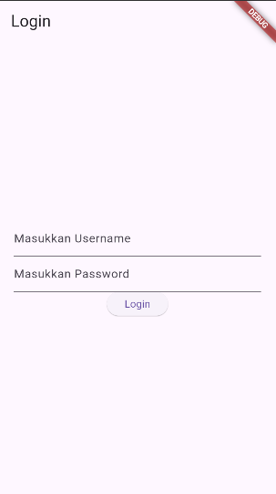

# Perkenalan Diri

**Nama** : Aditya Alfandy  
**NIM** : H1D024103  
**Shift Awal** : I  
**Shift Akhir** : H  

---

### Dokumentasi Praktikum 2

---

### Dokumentasi Praktikum 3

Berikut adalah hasil implementasi Modul 3 (Routes, Side Menu, Login, dan Local Storage):

| Halaman Login | Halaman Home & Side Menu | Halaman About |
| :---: | :---: | :---: |
|  |  |  |

---

### Dokumentasi Praktikum 4

Berikut adalah hasil implementasi Modul 4 (Operasi CRUD Produk, Registrasi, dan Login):

| Halaman Registrasi | Halaman Login | Halaman List Produk |
| :---: | :---: | :---: |
| .png) | .png) | .png) |

| Halaman Tambah Produk | Halaman Detail Produk | Halaman Ubah Produk |
| :---: | :---: | :---: |
| .png) | .png) | .png) |

---

### Dokumentasi Praktikum 5

Berikut adalah hasil implementasi Modul 5 (Membuat Helper Modul, BLoC, dan Integrasi REST API ke UI Flutter):

| Registrasi Berhasil | Peringatan Login Gagal | Halaman List Produk (REST API) |
| :---: | :---: | :---: |
| .jpeg) | .jpeg) | .jpeg) |

| Side Menu / Logout | Halaman Tambah Produk | Halaman Detail Produk |
| :---: | :---: | :---: |
| .jpeg) | .jpeg) | .jpeg) |

| Halaman Ubah Produk | List Produk Setelah Diubah |
| :---: | :---: |
| .jpeg) | .jpeg) |
